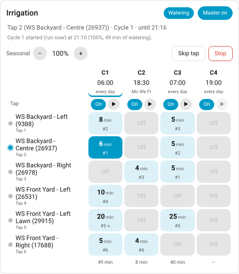
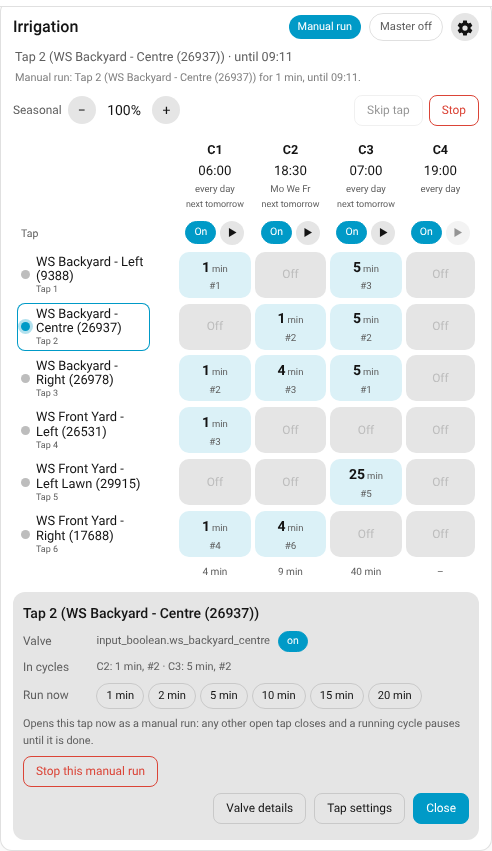
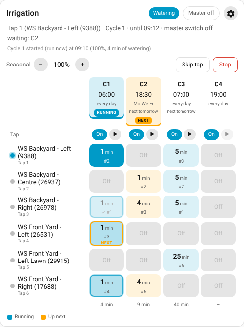
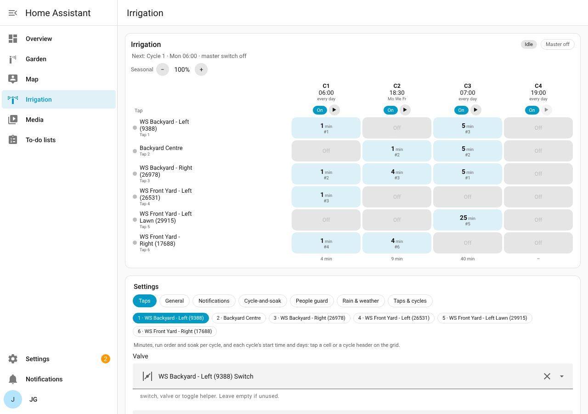

# Irrigation Scheduler

A Home Assistant custom integration that waters a garden **one tap (valve) at a time**, in a set order, over
several scheduled **cycles** a day, and recovers safely from manual use, restarts and outages. It has its own
entities, a settings page and an editable dashboard card: no YAML to write.

[](https://github.com/arrence-1/irrigation_Scheduler/actions/workflows/tests.yml)
[](https://github.com/arrence-1/irrigation_Scheduler/actions/workflows/validate.yml)

* Home Assistant **2026.9 or newer** (tested on 2026.9.4, 2026.10.0 and 2026.10.1, Python 3.14). No extra Python packages.
* Any `switch`, `valve` or `input_boolean` entity can be a tap (a Sonoff SWV via ZHA or Zigbee2MQTT is a `switch`).
* Metric units, 24 h times, your Home Assistant's time zone.



Tested: 96 automated tests against a real Home Assistant core, plus live UI tests: see [TESTING.md](TESTING.md).

| Notes | |
|---|---|
| [How it works](docs/how-it-works.md) | what it is made of, where the settings are kept, every way to change them |
| [Install](docs/install.md) | HACS, by hand, on another machine, moving machines, removing it |
| [Backup](docs/backup.md) | what to back up and how to get it back |
| [Updating](docs/updating.md) | how a new version gets to Home Assistant, and what to do if a Home Assistant update breaks it |

---

## Install

### HACS

[](https://my.home-assistant.io/redirect/hacs_repository/?owner=arrence-1&repository=irrigation_Scheduler&category=integration)

1. Click the button above, or in HACS: ⋮ → *Custom repositories* → add
   `https://github.com/arrence-1/irrigation_Scheduler` as **Integration**.
2. Download **Irrigation Scheduler** and restart Home Assistant.
3. Add the integration:

   [](https://my.home-assistant.io/redirect/config_flow_start/?domain=irrigation_sequencer)

   or *Settings → Devices & services → Add integration → Irrigation Scheduler*. Give it a name (`Irrigation`
   gives `switch.irrigation_master` …), the number of taps and cycles, and a valve for each tap (Toggle helpers
   for a first test).
4. Open **Irrigation** in the sidebar, give the cycles their minutes, and turn the **master switch** on (it starts
   off, so nothing waters until you do).

New versions then show up under *Settings → Updates* like any other update.

### Manual

Download `irrigation_sequencer.zip` from the newest [release](https://github.com/arrence-1/irrigation_Scheduler/releases)
and unzip it into `config/custom_components/` (you should end up with
`config/custom_components/irrigation_sequencer/manifest.json`), then restart Home Assistant.

Requires Home Assistant 2026.9 or newer.

### Dashboard card

*Edit dashboard → Add card →* search **Irrigation Scheduler** (or YAML `type: custom:irrigation-sequencer-card`).
The integration adds the card to your dashboard resources itself. If your dashboard resources are in YAML mode, add
`/irrigation_sequencer_static/irrigation-sequencer-card.js` (type `module`) to them.

### Before you switch the real valves over

Two schedulers must never drive the same valves: this integration times *every* tap that is switched on (a
manual run closes after its timer), so while other irrigation
automations or blueprints still switch the valves, point it only at **Toggle helpers** (pretend valves). When you
switch over, **disable** the old automations (don't delete them: they are your fallback, see
[Updating](docs/updating.md)), then give the integration the real valves.

**Hardware backstop.** If the integration is stopped, disabled or fails to load, nothing closes the taps. Set each
valve's own auto-off timer (most smart water valves have one) as a backstop, and use the master switch rather than
disabling the integration.

---

## What you get

### Entities
| Entity | Purpose |
|---|---|
| `switch.irrigation_master` | Off = no scheduled cycles (manual runs still work, and still get their timer) |
| `switch.irrigation_cycle_N` | Each cycle's own on/off (attributes: start time, days, minutes per tap, next start) |
| `number.irrigation_seasonal_adjustment` | 0-200 % slider on every scheduled duration (0 % = cycles skipped) |
| `sensor.irrigation_status` | idle / watering / gap / soaking / waiting (people) / offline (waiting: valve offline) / held (bypass or main water off) / manual / stuck; attributes: cycle, tap, ends at, remaining per tap, waiting cycles, main water (on / off / offline), offline / skipped valves, battery % per tap, low batteries, next battery report, last message |
| `sensor.irrigation_next_cycle` | Next scheduled start (timestamp); attributes: cycle, master, reason (why there is none) |
| `binary_sensor.irrigation_tap_N_blocked` | People guard is holding this tap back |

### Actions (services)
`irrigation_sequencer.run_cycle` (cycle) · `irrigation_sequencer.stop` · `irrigation_sequencer.skip_tap` (tap) ·
`irrigation_sequencer.run_tap` (tap, minutes) · `irrigation_sequencer.close_main_water` ·
`irrigation_sequencer.open_main_water` · `irrigation_sequencer.snooze_main_water_reminders` (hours) ·
`irrigation_sequencer.skip_offline_tap` (tap, skip) · `irrigation_sequencer.snooze_battery_warnings` (hours) ·
`irrigation_sequencer.send_battery_report` · `irrigation_sequencer.skip_next_cycle` ·
`irrigation_sequencer.skip_watering` (hours, 0 = run as scheduled). *Run cycle* ignores the master / cycle switches and the weather
and soil checks (it is an explicit "run it now").

### The dashboard card
A taps x cycles grid: each cell shows minutes, run order (#) and cycle-and-soak (≈); **Off** cells are greyed and
still show their run order faintly (the number is kept for when the tap gets minutes again).
Tap a cell to edit minutes / run order / soak; tap a cycle header to edit its time and days; ▶ runs a cycle now.
There is no Save button: each change saves by itself after a short pause (a few quick taps on + make one save),
**Undo** puts back what it was when you opened it, **Done** closes the editor.
Live status, master switch, seasonal % (−/+), *Skip tap* and *Stop*. Editing needs an admin user.

* **Time left:** while a cycle runs, the status at the top right shows how long until it finishes watering
  ("Watering · 23 min left"; on a phone just "23 min left"); during a manual run, how long that run has left.
  It is an estimate from the run order, gaps and soak breaks: people waits and a bypass can only make it longer.
  The status sensor has it as `cycle_ends_at`.

* **Colours:** the cycle in progress is **blue** (RUNNING tag, the watering tap solid, finished taps dimmed with ✓);
  what is about to run is **amber** (NEXT tag on the waiting / next scheduled cycle, an outline and "next" on the
  next tap). A legend under the grid explains them.
* **Run order:** every tap in a cycle has its own number. Pick a number another tap has and the two swap; the list
  shows which tap has each number.
* **⚙ Settings** (admins): every setting below, right on the card, with a link to the Irrigation page.
* **Tap names are clickable:** run that tap now (1–30 min), stop or skip it while it runs, open the valve's
  details (with its battery %), skip it while its valve is offline, or open its settings (press *Tap settings*
  again to hide them).
* **Offline valve / low battery rows:** a valve that is offline shows a row with *Skip while offline* (tap twice);
  low batteries show a row with *Snooze 12 h / 1 day / 3 days*.
* **Next start:** each cycle header says when it runs next; the status line says how long until the next cycle,
  or why nothing is scheduled.





### The Irrigation page (sidebar)
**Irrigation** in the sidebar (admins): the grid on top and every setting below in tabs — Taps, General,
Notifications, Cycle-and-soak, People guard, Rain & weather, Main water, Offline valves, Batteries, Number of taps &
cycles. Same labels, help and
limits as the Configure screens. Changes save by themselves: a switch or a picker at once, a box you type in when
you pause or leave it ("All changes saved" at the bottom). Only *Taps & cycles* has a Save button, because a new
number of taps or cycles reloads the app. With more
than one Irrigation Scheduler (a test one, say), a button for each sits at the top: the highlighted one is shown,
and the settings heading names it too ("Settings · Irrigation"). The page remembers the one you pick last.



### Settings (Configure)
The same settings are still under *Settings > Devices & services > Irrigation Scheduler > Configure*.
One screen per group: **Cycles** (time, days, and per tap minutes / run order / soak, each tap in its own box),
**Taps** (valve, name, people sensors, soil sensor + "wet enough at", bypass switch), **General** (gap 5 s,
confirm timeout 30 s, safety limit 20 min, running-late 30 min, optional seasonal % entity), **Notifications**,
**Cycle-and-soak** (burst 3 / soak 5 min), **People guard** (clear for 2 min, give up after 30 min, also stop
manual runs), **Rain & weather skip**, **Main water**, **Offline valves** (wait 30 min, then stop the cycle or skip
the tap; ask 20 min ahead), **Valve batteries** (warn at 30 %, every 2 h, quiet 21:00-06:00; battery report every 14
days at 10:00), **Number of taps and cycles** (up to 16 taps and 12 cycles).

Good sensors to use:
* Rain: a 24 h rain total in mm (better for skipping than a raining yes / no flag, which flickers in real rain).
* Wind and temperature: a weather station's sensors, or the weather entity.
* People: person-occupancy sensors (e.g. Frigate cameras) that cover each tap's area.
* Soil: one moisture sensor per garden bed; leave lawn taps without one.

---

## How it behaves (the rules, same as the blueprint)

* **One tap at a time.** The next opens only after the previous one *reports* off, plus the gap. Equal run orders
  run in tap-number order (with a warning).
* **Manual runs win.** A tap switched on by hand runs for its longest cycle minutes (capped by the safety limit),
  then closes. The newest manual tap wins. A running cycle pauses and resumes with the unused time. A scheduled
  tap turned off by hand is skipped for that cycle.
* **Never dropped, only delayed.** A cycle due while something runs waits in a queue and starts when idle
  ("started X min late", "Running late:" past the threshold). The same cycle is never doubled.
* **Restarts / outages.** Saved state (in `.storage/irrigation_sequencer.<entry>`): a tap still within its time
  stays on (no blip); one past its time is closed and the cycle continues; cycles missed in the last 24 h run once;
  edited times don't cause surprise runs; one "Recovered after restart" message. After a restart it waits up to
  2 min for the valves to come online.
* **Safety.** No tap stays open longer than the safety limit in one go (longer taps run in parts). A tap that
  won't confirm off → *stuck*: nothing else opens (manual runs are closed again), retried every 5 min,
  time-sensitive alert, and the cycle resumes once it reports off. A valve that won't report on is skipped.
* **Offline valves** (*Offline valves* tab). No tap opens while another valve is offline (e.g. a flat battery),
  because it can't be confirmed closed, even if that tap is Off in the cycle. The cycle waits and you get a
  time-sensitive notification: press and hold for **Skip while offline** (needs Face ID / unlock) or **Stop the
  cycle**. A skipped tap sits every cycle out until it reports back online, then it is in again by itself (if it
  comes back reporting open it is closed at once). With no answer after 30 min (setting) the cycle stops, or, with
  *With no answer: skip*, it skips the tap and carries on. You are also asked 20 min before a cycle, so the start
  isn't held up. A valve **last seen open** is never skipped (it may still be running): that is the stuck-tap and
  main water alert.
* **Main water** (optional, *Main water* tab). Pick the valve that supplies every tap (switch, valve, toggle helper
  or light; on = water flowing). A tap stuck for the set time (default 10 min) raises a **critical** alert with a
  **Close main water** button (press and hold the notification); with *Close the main water automatically* on, the
  app closes it itself and tells you. While the main water is off, cycles wait (a running tap stops and keeps its
  time) and run, late, once it is on again. The app **never opens** the main water by itself: when the tap reports
  off you get an **Open main water** button (phone unlocked), also on the card. While it is off you are **reminded
  every 30 min** (setting) with *Open main water*, *Snooze 1 h* and *Snooze…* (type the hours); the reminders start
  again when the snooze ends. 20 and 10 min before a cycle that would run you get a reminder too (even when snoozed).
* **Valve batteries** (*Batteries* tab). Each tap's battery sensor is found on its valve's device (or set under the
  tap). At or below 30 % (setting) you get a warning, repeated every 2 h until the batteries are changed (fine again
  5 % above the level), never in the quiet time (21:00-06:00; held until it ends). Press and hold: *Snooze 1 day* or
  *Snooze…* (type hours or days: 12, 2d, 1 week); a valve that gets low later still warns. The **battery report**
  lists every valve's level every 14 days at 10:00 (pick the days, time and a first date; *Send report now* on the
  Batteries tab or `send_battery_report`).
* **Skip watering** (*Skip next cycle* on the card, the actions, or a notification button such as a rain alert's):
  skips the next scheduled cycle, or every cycle for some hours, and stops the running one. *Run now* still runs.
  Phone action ids for your own notifications: `irrigation_skip_next`, `irrigation_skip_24`, `irrigation_skip`
  (text input: hours or days).
* **Forecast: need both** (on by default): with a forecast chance and amount both set, a cycle is skipped only when
  both are met; a note tells you when only one was. BOM gives a range: its top is the amount (1-5 mm counts as 5).
* **Smart checks** at each cycle start: seasonal %, hot-day boost (≤ 250 % total), rain sensor / weather /
  forecast chance / forecast mm / wind / cold skips (one switch for all), soil per tap, people guard per tap.
* **Bypass (pressure washer).** While a tap's bypass switch is on, that tap is left alone (no timer) and cycles
  are held (the washer keeps full pressure); they run, late, when the bypass goes off. A tap still on 30 s after
  the bypass ends becomes a normal manual run.
* **Alerts.** Too hot for 10 min (once; re-armed after it drops 1 °C below the limit). Started raining (once;
  re-armed after 30 min dry, because the piezo flag flickers in real rain).

### Notifications
Sent to the phones you pick (`notify.mobile_app_<device>`), all in one group / iOS thread; each type has its own
tag so a newer message replaces the older one; messages with the same tag in one pass are merged.

| Message | Switch | Tag |
|---|---|---|
| Cycle started / finished | Cycle started and finished | `irrigation_cycle_N` |
| Started late / Running late / stopped by a switch | always | `irrigation_cycle_N` |
| Cycle skipped or tap skipped (with reasons) | Cycle or tap skipped | `irrigation_cycle_N` |
| Manual run started / finished / replaced | Manual runs | `irrigation_manual` |
| People guard | People guard | `irrigation_people_N` |
| Master off reminder 20 / 10 min before, with **Turn master switch on** button (cleared later) | Reminders | `irrigation_reminder_N` |
| Too hot (button if master is off) | Too hot at | `irrigation_hot` |
| Started raining | Started raining | `irrigation_rain` |
| Tap fault (time-sensitive on iOS) | always | `irrigation_tap_N` |
| Tap won't close: close the main water? (**critical**, with **Close main water** button) / closed / open again (with **Open main water** button) | always (needs a main water valve) | `irrigation_main` |
| Main water is off: every 30 min, with **Open main water**, **Snooze 1 h**, **Snooze…** (type hours) | *While it is off, remind me every* | `irrigation_main` |
| Cycle N starts in 20 / 10 min but the main water is off (**Open main water** button; cleared later) | *Remind me before a cycle* | `irrigation_main_cycle_N` |
| Valve offline: cycle waiting (time-sensitive, **Skip while offline** / **Stop the cycle**), asked 20 min ahead, skipped / back online | always | `irrigation_offline` |
| Low battery, repeating (**Snooze 1 day**, **Snooze…** type hours or days) / snoozed / fine again | *Warn at or below* (0 = off) | `irrigation_battery` |
| Battery report: every valve's level | *Battery report* | `irrigation_battery_report` |
| Recovered after restart / reload | always | `irrigation_recovery` |
| Settings warnings | always | `irrigation_config` |

Every message is also fired as the event `irrigation_sequencer_message` (for your own automations), and the
last one is on `sensor.irrigation_status` (`last_message`). iOS time-sensitive needs the Companion app's
*Time Sensitive* permission, critical alerts its *Critical Alerts* permission (iOS Settings > Notifications >
Home Assistant).

---

## Test checklist (with Toggle helpers first, 1-3 min durations)

- [ ] A cycle runs taps in its run order, one at a time, with the gap between them
- [ ] Two cycles with different run orders each follow their own order
- [ ] Tap on by hand before a cycle: runs its timer; the cycle starts after it with a "late" message
- [ ] Tap on by hand mid-cycle: current tap pauses, resumes with its remaining time
- [ ] Second manual tap: the first one closes
- [ ] Scheduled tap turned off by hand: skipped, cycle continues
- [ ] Restart mid-tap: tap stays on, closes on time, "Recovered after restart"
- [ ] Master off mid-cycle: tap closes, cycle cancelled; reminders 20 / 10 min before the next one; button works
- [ ] Cycle-and-soak: other taps fill the soak time; seasonal 120 % / 0 %; weather skip; soil; people guard
- [ ] Bypass on: Tap 1 left alone, cycles held, run late when it goes off
- [ ] A valve offline at a cycle start: the cycle waits and asks; Skip while offline waters the rest; back online = in again
Then swap in the real valves with short durations and watch one full cycle.

## Known limits
* Disabled / removed integration = nothing closes taps (use the master switch; set the valves' own timers).
* An offline valve holds every cycle until it is back, skipped, or the wait is over (one-tap-at-a-time rule).
* Avoid start times in the daylight-saving change hour (02:00-03:00 on the change day).
* Changing a running tap's valve entity closes the old valve; change valves while idle.

## Development
`custom_components/irrigation_sequencer/engine.py` holds every rule in one pure-Python `reconcile()` (no Home
Assistant imports); `coordinator.py` is the Home Assistant glue; the card, its settings and the Irrigation page are
one plain JavaScript file (`frontend/irrigation-sequencer-card.js`, no build step). More in
[How it works](docs/how-it-works.md).

```bash
python3.14 -m venv .venv && . .venv/bin/activate
pip install -r requirements_test.txt      # the Home Assistant version the current release is tested on
pytest -q && ruff check .
```

`tools/gen_translations.py` regenerates `translations/en.json`. Releasing a new version (`tools/bump_version.py`,
CHANGELOG, then *Actions > Release > Run workflow*): see [Updating](docs/updating.md).
